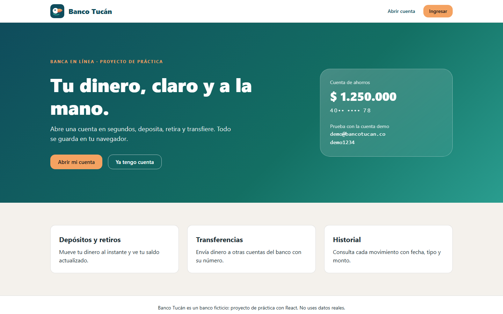
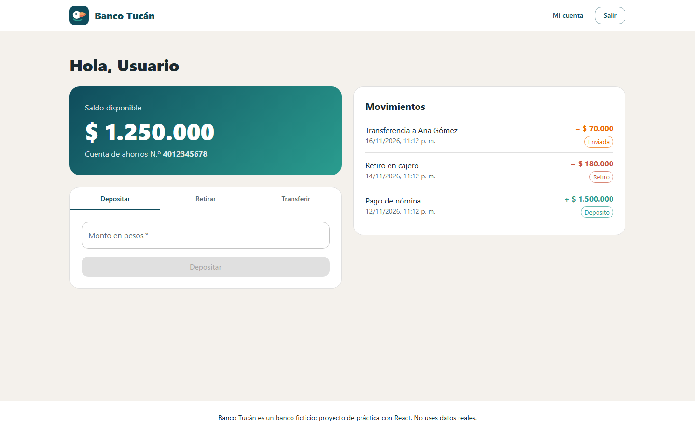

# Banco Tucán · Cuenta bancaria en React

> **Proyecto de práctica.** "Banco Tucán" es un banco **ficticio**: el nombre y el logo son inventados y no tienen relación con ninguna entidad financiera real. No ingreses datos reales.

Aplicación de banca en línea hecha con **React + Vite + Material UI**: registro, inicio de sesión, saldo, depósitos, retiros, transferencias entre cuentas e historial de movimientos.

**Demo:** https://alejo234506.github.io/cuenta_bancaria/

Cuenta de prueba: `demo@bancotucan.co` / `demo1234` (para transferir puedes usar la cuenta `4098765432` de Ana Gómez).




## Funcionalidades

- Registro e inicio de sesión con validación y mensajes de error.
- Ruta privada `/cuenta`: si no hay sesión, redirige al login.
- Depósitos, retiros y transferencias con validación de saldo y montos.
- Historial de movimientos con fecha y tipo, valores en pesos colombianos (COP).
- Diseño responsive y accesible (formularios con etiquetas, foco visible, contraste).

## Cómo funciona el "backend"

La API externa que usaba la primera versión ya no existe, así que el proyecto usa un backend **simulado** en [`src/services/banco.js`](src/services/banco.js): los usuarios y movimientos se guardan en el `localStorage` del navegador y cada operación tiene una pequeña espera para imitar una petición real. Para empezar de cero basta con borrar los datos del sitio en el navegador.

## Ejecutar en local

Requiere Node.js 24.

```bash
npm install
npm run dev      # servidor de desarrollo
npm run lint     # revisar el código con ESLint
npm run build    # compilar a dist/
npm run preview  # probar la versión compilada
```

## Despliegue

Cada push a `master` ejecuta el workflow [`.github/workflows/deploy.yml`](.github/workflows/deploy.yml), que compila el proyecto y lo publica en GitHub Pages. Se usa `HashRouter` (rutas como `/#/login`) para que las rutas funcionen en Pages sin configuración extra, y `base: '/cuenta_bancaria/'` en `vite.config.js`.

## Estructura

```
src/
├── Components/   Navbar, Layout, RutaPrivada, FormularioTarjeta
├── context/      AuthContext (sesión del usuario)
├── pages/        Inicio, Login, Registro, Cuenta
├── services/     banco.js (backend simulado)
├── utils/        formato de pesos y fechas
└── theme.js      tema de Material UI
```
